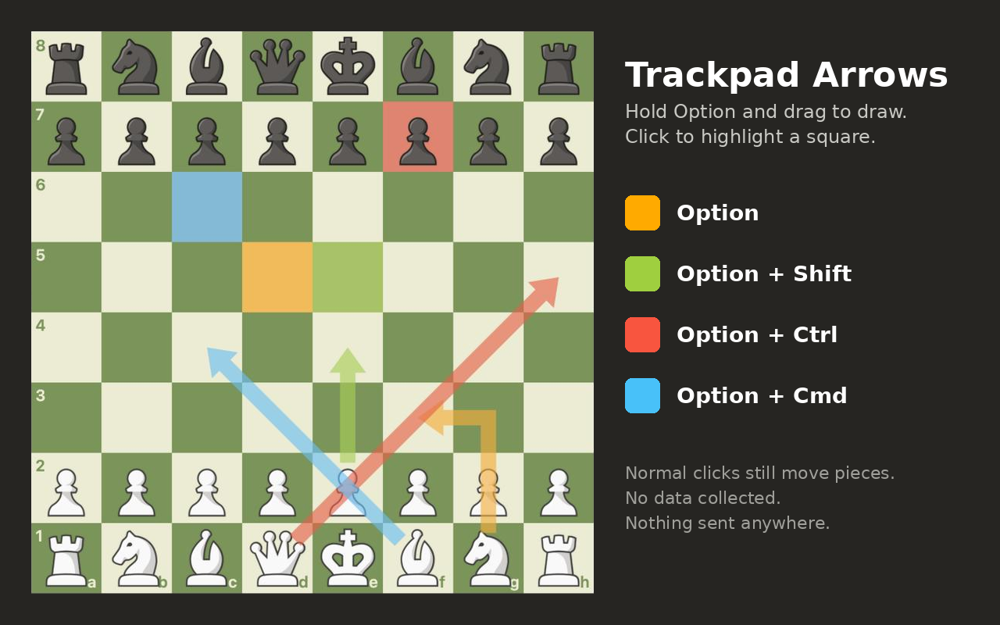

# Chess Option-Drag

Browser extension (Firefox ≥140, Chrome ≥111) for chess.com: hold a modifier key (Option by default) while clicking/dragging on the board to draw square highlights and arrows — no right-click needed, so it works from a trackpad.



- **Option + drag** → arrow
- **Option + click** → square highlight
- Normal clicks and piece moves are untouched.

The key (Option/Alt, Shift, Command, Control) is configurable from the toolbar popup or the add-on's preferences page. Changes apply instantly.

## Privacy

No data is collected or transmitted. The only stored value is the chosen key, kept in the browser's extension storage (`storage.sync`).

## Development

```bash
npm install        # dev tooling only (web-ext)
npm test           # unit tests (node:test, no browser needed)
npm run lint       # web-ext lint (same linter AMO runs)
npm run build      # → chess-option-drag.zip
npm run icons      # regenerate icons/*.png
npx web-ext run    # launch Firefox with the extension loaded
```

## Releasing to addons.mozilla.org

1. Bump `version` in `manifest.json` (and `package.json`).
2. `npm run check && npm run build`
3. Upload `chess-option-drag.zip` at https://addons.mozilla.org/developers/.
4. Source code upload is not required: all code is unminified and unbundled.

## Releasing to the Chrome Web Store

Same zip as AMO (Chrome ignores `browser_specific_settings` with a harmless warning). Also covers Brave/Vivaldi/Arc/Opera; Edge Add-ons (partner.microsoft.com) accepts the same zip.

1. Bump `version`, `npm run check && npm run build`.
2. Upload `chess-option-drag.zip` at https://chrome.google.com/webstore/devconsole (one-time $5 fee, 2-step verification required).
3. Store listing:
   - Category: Fun (or Productivity); language: English.
   - Icon: `icons/icon-128.png`. Screenshot: `store-1280x800.png`. Small promo tile: `store-promo-440x280.png`.
   - Description: the intro and bullet list at the top of this README.
4. Privacy practices tab:
   - Single purpose: *On chess.com, holding a modifier key while clicking/dragging on the board draws arrows and square highlights (normally right-click only), so it works from a trackpad.*
   - `storage` justification: *Stores the user's chosen modifier key (Option/Alt, Shift, Command, Control) so the setting persists.*
   - Host permission justification (content scripts on chess.com): *The content script must run on chess.com to convert modifier + click/drag on the board into right-click/drag events. It runs on no other site.*
   - Remote code: **No**.
   - Data usage: tick nothing; certify all three statements. Privacy policy URL (optional): link to the [Privacy](#privacy) section above.

## License

[MIT](LICENSE)
